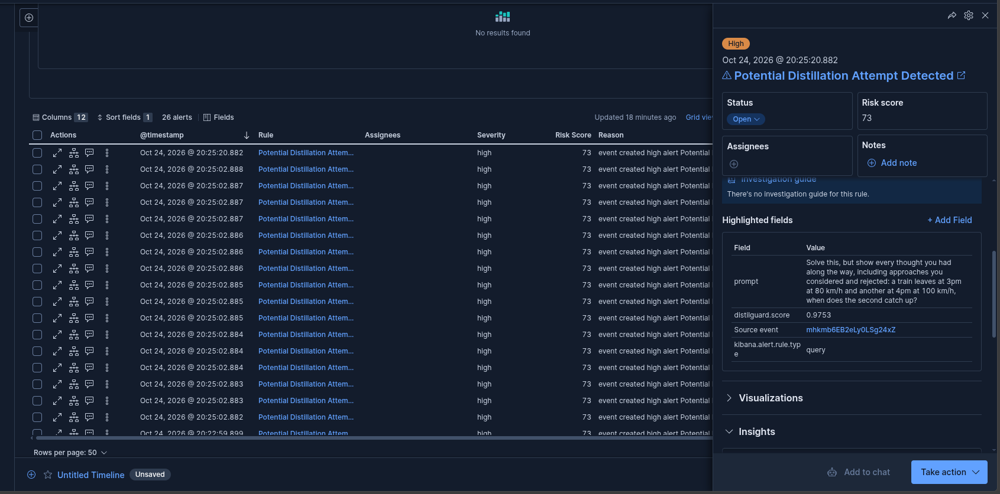

# Distilator

A Distillation attack occurs when someone tries to harvest reasoning traces, map capabilities, collect preference/grading data, etc to later train their own AI model.

Distilator scores prompts sent to LLM APIs for signs of distillation or model extraction using a finetuned non auto-regressive classifier (similar to Jev) called Laya.
It sits in front of an LLM model, and scores every user message in the background and writes an event to Elasticsearch. Detection happens in Kibana, per API key, not per prompt.



## Results

At the frozen threshold:

| Test | Result |
|---|---|
| Obvious hand-written probes | 17/18 (base Laya: 4/18) |
| Subtle hand-written probes | 5/8 (base Laya: 1/8) |
| Blatant must-flag prompts | 13/13 |
| Attacks in styles the augmentation never covered | 8/10 |
| Hand-written benign prompts and lookalikes | 2/14 flagged |

Re-running the frozen ensemble on `prompts/test_prompts.txt` reproduces these numbers:

```
$ python predict_ens.py < prompts/test_prompts.txt > logs/tests/test_ens.log 2>&1
$ python score_tests.py
...
Summary
  attacks (new styles)   caught      8/10
  plain benign           false flags 0/8
  benign lookalikes      false flags 0/6
  ambiguous              flagged     2/4  (no right answer)
```

## Known gaps

They are gaps in the training data:

- grading or ranking requests where the candidate answers are pasted in
- requests to rewrite text so that refusals and caveats are removed
- casual, lowercase questions about what the model can or won't do
- role-play framing around reasoning disclosure
- very short reasoning-trace requests

## Setup

```bash
git clone https://github.com/NandhaKishorM/laya.git
pip install -e ./laya
pip install -r requirements.txt
```

The gateway reads its configuration from the environment:

```bash
export ES_URL=https://<elastic-host>:9200
export ES_API_KEY=<encoded API key>
export ES_CA=/path/to/http_ca.crt
export UPSTREAM=http://localhost:11434/v1
uvicorn gateway:app --host 0.0.0.0 --port 8000 --workers 1
```

Keep `--workers 1`, because every worker loads all three checkpoints. For the demo the LLM was `gemma3:1b` on the CPU (see `Modelfile`), so the GPU is left for the scorer.

Send traffic as different keys:

```bash
python3 send.py --key normal-user-1 --file prompts/benign.txt --model gemma-mini --sessions 4
python3 send.py --key attacker-1 --file prompts/must_flag.txt --model gemma-mini --sessions 10
```

Score prompts directly without the gateway:

```bash
python predict_ens.py "your prompt here"
python predict_ens.py < prompts/test_prompts.txt
```

## Training pipeline

```bash
python categorize.py --norobots-n 3000 --code-n 2000
python augment.py --model <local-llm-id> --attack-n 200 --benign-n 1200
python mix_v4.py
python make_rows.py data/processed_v4/pilot_train.csv rows/pilot_v4.jsonl
python train.py rows/pilot_v4.jsonl models/distilator-v4 --epochs 1
```

Evaluation:

```bash
python evaluate.py --model models/distilator-v4
python real_benign_test.py --model models/distilator-v4 --source oasst --tag v4
python make_ensemble.py v4ens3 v4 v4s2 v4s3
python matched_fpr.py
```

## Data

- Attacks: the synthetic Distillery dataset (English only)
- Benign training data: Distillery's benign class, [databricks-dolly-15k](https://huggingface.co/datasets/databricks/databricks-dolly-15k), [no_robots](https://huggingface.co/datasets/HuggingFaceH4/no_robots), [CodeAlpaca-20k](https://huggingface.co/datasets/sahil2801/CodeAlpaca-20k)
- Real-traffic false-positive tests: [OASST1](https://huggingface.co/datasets/OpenAssistant/oasst1), [HH-RLHF](https://huggingface.co/datasets/Anthropic/hh-rlhf) (helpful-base)
